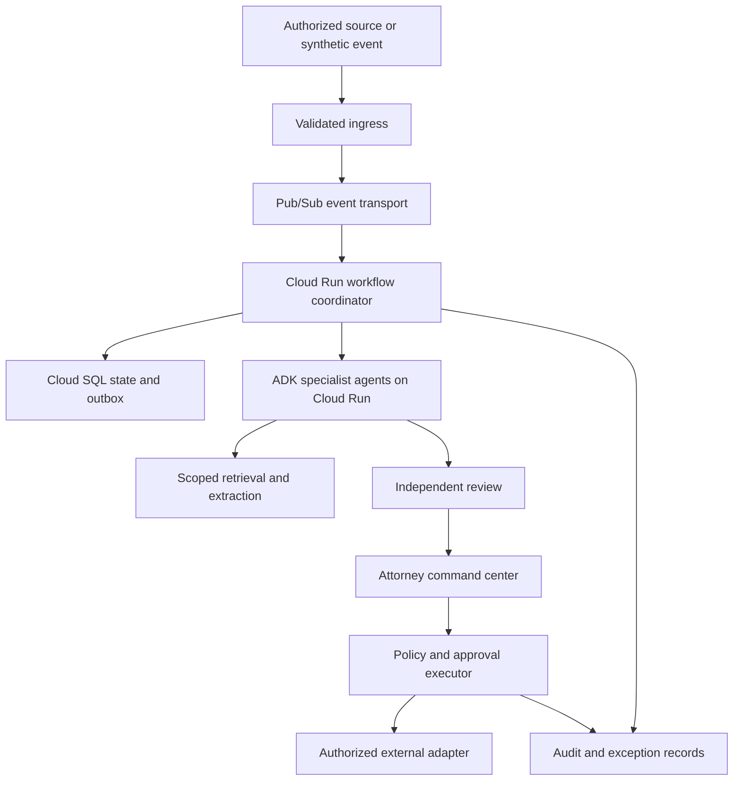

# Proposed architecture — v0.1

Status: proposed deployment architecture, not deployed. The future Google ADK + Gemini + Cloud SQL for PostgreSQL stack is locked by [ADR-002](docs/DECISIONS.md). PR1 implements local deterministic controls, synthetic unit tests, and disposable PostgreSQL migrations/suites whose live PostgreSQL 16+ execution (`WEAVERLAW_REQUIRE_LIVE_PG=1 python -m pytest -v`) is a required pre-merge gate (GitHub Actions CI is not yet enabled); versions, availability, quotas, costs and data terms must be confirmed before provisioning.

## Goals
An incoming event or human request becomes a durable, matter-scoped job; deterministic orchestration invokes bounded specialists; source-linked findings and proposed actions reach an attorney review queue. Only an authorized executor can perform an approved external effect. The agent never bypasses policy.

## Service map
| Layer | Proposed implementation | Responsibility |
| --- | --- | --- |
| UI | Next.js / TypeScript on Cloud Run | Authenticated matter, run and approval views |
| API / worker | Python on Cloud Run | Validate events, authorize access, coordinate jobs |
| Agent runtime | Google ADK + Gemini, future activation only | Bounded analysis and delegation; no independent authority |
| Events | Pub/Sub; Eventarc when appropriate | At-least-once delivery assumed; no ordering assumption |
| Schedules | Cloud Scheduler | Authorized recurring jobs and reconciliation |
| State | Cloud SQL PostgreSQL | Transactional event inbox, run state, approvals, effects, audit |
| Documents | Cloud Storage and Document AI only if approved | Minimal permitted copies and extraction; originals remain in Dropbox |
| Retrieval | Scoped PostgreSQL search; vector retrieval optional | Access filtering before retrieval, provenance and source versions |
| Orchestration | Python state machine first; Cloud Workflows optional | Durable checkpoints, review and retry; avoid duplicate runtimes |
| Security | IAM, Secret Manager, short-lived workload identity | Per-service identity, controlled secrets, restricted access |
| Operations | Cloud Logging, Monitoring, Audit Logs | Redacted telemetry, alerts and operational evidence |
| Delivery | GitHub + CI; Cloud Build or GitHub Actions later | Reviewed reproducible releases; no deployment pipeline active |

## Authoritative boundaries
Clio owns official matter/client identifiers and case management. Dropbox owns original case documents and evidence. Gmail/Calendar own communication and calendar source records. Licensed research platforms provide authorities subject to rights and access review. GitHub owns software definitions only. Cloud SQL owns WeaverLawAgents run state, mappings and proposals, not authoritative legal facts. Avoid duplicating originals unless approved; derived extracts, indexes and caches inherit source restrictions.

## Contracts and data flow
Ingress validates provider identity, freshness, schema, size and replay protections. Normalize an event envelope: schema_version, event_id, source, event_type, occurred_at UTC, received_at UTC, correlation_id, source_ref, source_version, optional verified matter_id, sensitivity, dedup_key. No full payloads in queue or logs; use scoped references. Persist inbox and enqueue/outbox atomically where possible; acknowledge after durable acceptance. Unknown or conflicting matter identity quarantines the run; never guess.

Proposed tables: matter_mapping, event_inbox (unique source + dedup_key), workflow_run, workflow_step, agent_run, source_reference, work_product, action_proposal, approval, effect_journal, outbox, audit_event. Every matter-scoped record carries verified scope; enforce database and application object-level checks. Run transitions: RECEIVED -> VALIDATED -> RUNNING -> REVIEW_REQUIRED -> APPROVED -> EXECUTING -> COMPLETED; terminal/exception states REJECTED, FAILED, QUARANTINED, CANCELLED, NEEDS_RECONCILIATION. Read-only workflows may finish without action approval. Persist transitions and reason codes; no direct transition from AI output to execution.

Approval binds exact action digest, source versions, matter, reviewer, policy version, expiry and destination. Executor rechecks identity, permission, freshness, approval, idempotency and kill switch; changed inputs invalidate approval. Ambiguous external success requires reconciliation, not blind retries. Use bounded attempts, exponential backoff with jitter, dead-letter handling, per-run cost/time limits and manual replay checks.

## Environment and delivery
Separate development, staging and production projects, service accounts, databases, storage and secrets. Proposed names are labels only; actual globally unique project IDs require confirmation. Development and staging initially synthetic only. Use Terraform or equivalent reviewed IaC later; plan before apply, isolate remote state, no automatic production release. Promote immutable artifacts with recorded code/model/policy versions. Production approval, monitoring, backup restore rehearsal, rollback and incident ownership required.

## Open decisions
Region/residency, Workspace OAuth scopes and consent, API licenses and quotas, actual deployment model, retention and legal hold schedule, identity provider, budget limits, recovery objectives, and pilot owner must be approved. No assumptions about availability of ChatGPT connectors in the deployed application. Use separately authorized provider APIs.

## Provider references
- [ADK documentation](https://google.github.io/adk-docs/)
- [Cloud Run](https://cloud.google.com/run/docs)
- [Pub/Sub](https://cloud.google.com/pubsub/docs)
- [Gmail push notifications](https://developers.google.com/workspace/gmail/api/guides/push)
- [Document AI security](https://docs.cloud.google.com/document-ai/docs/security)
- [Workload identity federation](https://cloud.google.com/iam/docs/workload-identity-federation)
